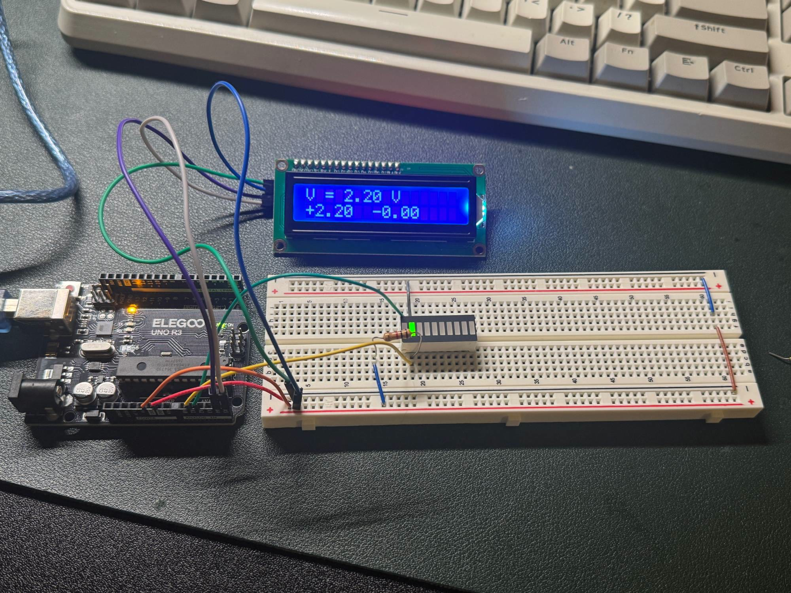

# CMPE 310 Lab 8

Demo video: [videos/lab8-demo.mp4](videos/lab8-demo.mp4)

## Upload and run

Install `LiquidCrystal_I2C` from **Sketch → Include Library → Manage Libraries**. Open `continuity/continuity.ino` for Task 1 or `voltage_measurement/voltage_measurement.ino` for Task 2, select **Arduino Uno** and its COM port, and click **Upload**.

## Task 1: Continuity

One probe wire goes to D2 and the other goes to GND. D2 uses the internal pull-up resistor, so it reads HIGH when the probes are apart. When the probes touch, or are connected through a closed path, D2 is pulled LOW and the LED turns on. The LED is wired D13 → 220 Ω → LED → GND.

- Open wire: LED off
- Closed wire: LED on

## Task 2: DC voltage measurement

The LCD connects over I2C: GND → GND, VCC → 5V, SDA → A4, SCL → A5. The + probe goes to A0 and the − probe goes to A1. The circuit under test shares the Arduino's GND. The sketch averages 20 readings on each pin, subtracts them, and shows the voltage between the probes on line 1 of the LCD. Line 2 shows each probe's voltage.

The test circuit is an LED in series with a resistor, powered from 5V.

| Case | Measured |
| --- | ---: |
| A: across the LED | 2.20 V |
| B: across the resistor | |
